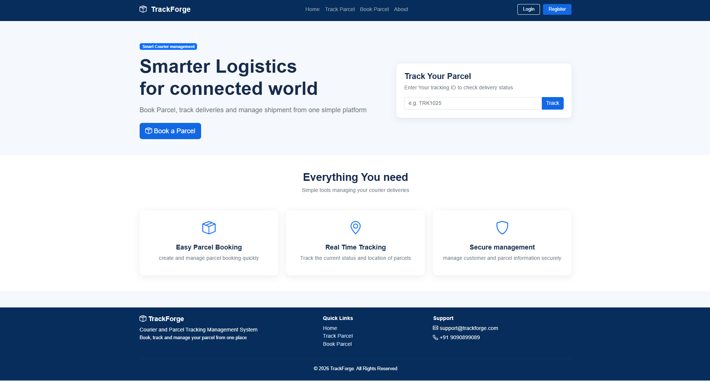
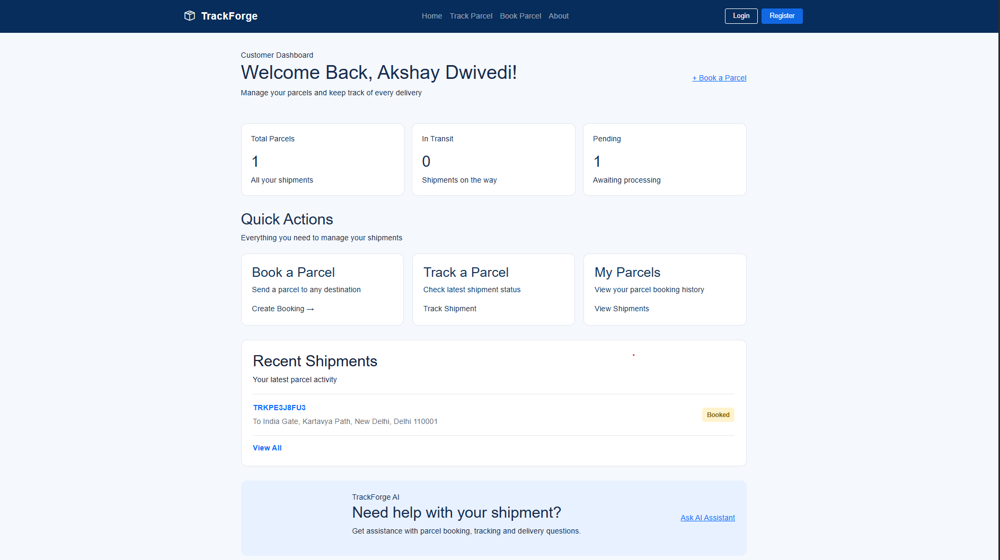
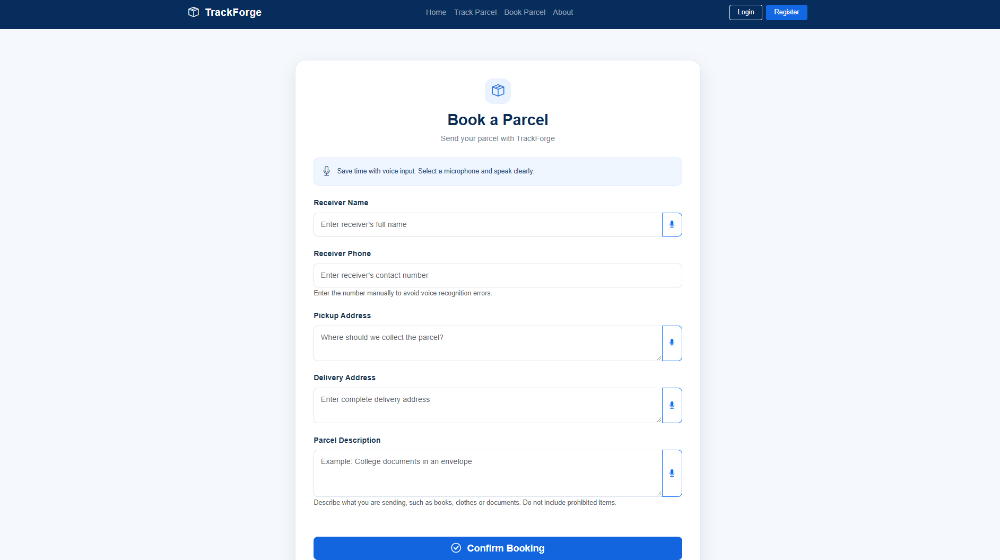
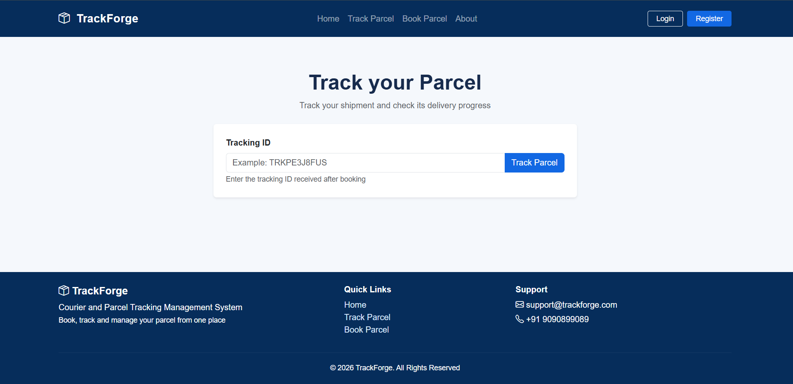
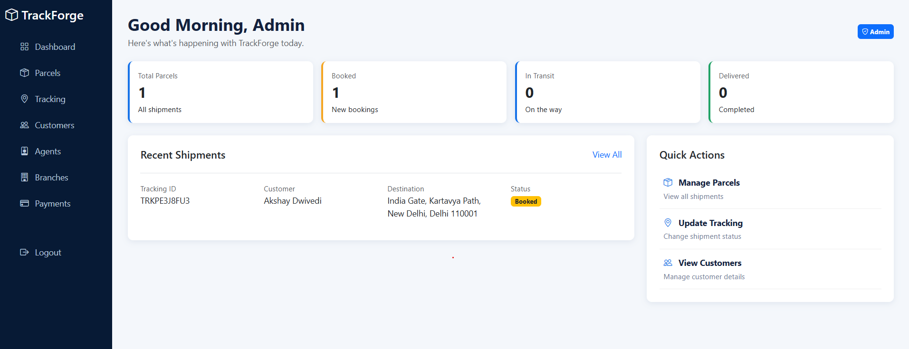
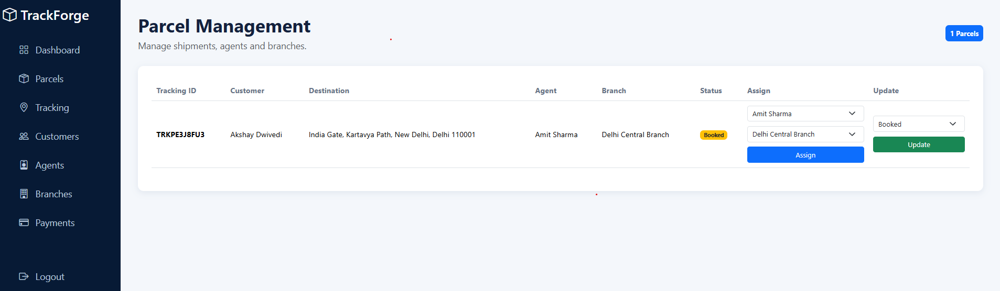
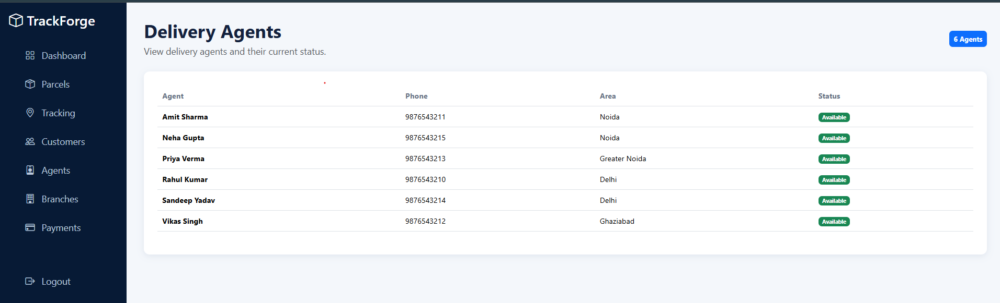

# TrackForge
### AI-Assisted Courier Booking and Parcel Tracking Management System

TrackForge is a web-based courier management system developed as an academic DBMS project. It helps users book parcels, track shipments, and manage delivery information through a simple interface.

## Features

- User registration and login
- Parcel booking
- Personal parcel dashboard
- Shipment tracking
- AI-assisted shipment support
- Admin dashboard
- Customer management
- Delivery agent management
- Branch management
- Parcel and payment management
- Tracking history

## Technologies Used

- Python
- Flask
- MySQL
- HTML
- CSS
- Bootstrap

## Application Screenshots

### Home Page


### Customer Dashboard


### Parcel Booking


### Parcel Tracking


### Admin Dashboard


### Admin Parcel Management


### Admin Agents


## Project Structure

```text
Courier_system/
├── app.py
├── Courier.sql
├── .gitignore
├── static/
│   ├── style.css
│   └── style_admin.css
└── templates/
    ├── Admin/
    └── User/
```

## Installation and Setup

1. Clone the repository:

   `git clone https://github.com/Akshaydwivedi0/TrackForge.git`

2. Open the project folder:

   `cd TrackForge`

3. Create and activate a virtual environment:

   `python -m venv .venv`

4. Install dependencies:

   `pip install Flask mysql-connector-python python-dotenv`

5. Create the MySQL database by running `Courier.sql` in MySQL.

6. Create a local `.env` file containing your database configuration:

   ```env
   DB_HOST=localhost
   DB_USER=your_mysql_username
   DB_PASSWORD=your_mysql_password
   DB_NAME=Courier
   FLASK_SECRET_KEY=your_private_secret_key
   ```

7. Run the application:

   `python app.py`

8. Open `http://127.0.0.1:5000/` in your browser.

## Security

- Keep `.env` private.
- Never upload database passwords or secret keys.
- Do not commit your virtual environment.

## Project Information

**Project Name:** TrackForge  
**Project Type:** DBMS Project  
**Developer:** Akshay Dwivedi

---

*Developed for academic learning and practical implementation of database management concepts.*
